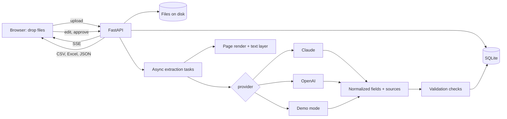

# PRD: paperwork-ai, invoices and receipts in, clean spreadsheet rows out

Status: v1, ready to build
Shared rules: [STANDARDS.md](STANDARDS.md)

## 1. Overview

Small businesses lose hours every week typing supplier invoices, receipts and forms into spreadsheets and accounting tools. The data is all there on the page; it just isn't in rows and columns. This project shows the product a client would actually buy: **drop a pile of PDFs and photos into a batch, get validated, structured data back, fix anything the app flags, and export it to CSV, Excel, Google Sheets or JSON.**

The pitch is "Stop typing invoices into spreadsheets." The selling point is not the AI, which anyone can call. It is the **"trust but verify" layer**: every number is checked (line items add up to the subtotal, subtotal plus tax equals the total, dates are real, the currency is consistent, the invoice isn't a duplicate) and every field shows where on the page it came from. A bookkeeper can see in seconds which documents are safe to approve and which need a human.

**Portfolio goals:**
- Sell the service: "I can automate your document data entry, with checks you can trust."
- Prove Python/FastAPI backend skill, document processing (PDFs, scans, photos), LLM structured outputs done carefully, evals, and a review UI that is pleasant on desktop and phone.

**Audience:**
- Small business owners, bookkeepers and office managers who process supplier invoices, expense receipts or intake forms.
- Anyone checking Python/FastAPI, AI integration and frontend skill.

## 2. Goals and non-goals

**Goals**
- Upload many files at once (PDF, PNG, JPG) and watch each one move through queued, extracting, needs review and approved.
- Review each document side by side: the page on the left, the extracted fields on the right, with confidence and a "show source" highlight for every field.
- Catch AI and document mistakes with visible validation checks that explain what is wrong in plain language.
- Edit, re-check, approve, and export a batch in the formats small businesses already use.
- Claude and OpenAI behind one switchable interface, with a deterministic demo mode that needs no keys.
- An eval harness with ground truth for every sample document, reporting field accuracy and how many mistakes validation catches.

**Non-goals**
- Accounting integrations (QuickBooks, Xero). The README lists them as the obvious next step.
- Accounts, teams or permissions. A batch is identified by an unguessable id.
- Long-term storage. Demo data is deleted after an hour.
- Our own OCR engine. The providers read scans and photos natively.
- Payments, approvals workflows or email ingestion.

## 3. User stories

| # | As a... | I want to... | So that... |
|---|---------|--------------|------------|
| 1 | bookkeeper | drag a folder's worth of invoices into the page | I don't upload them one at a time |
| 2 | bookkeeper | see each document's status update live | I know when I can start reviewing |
| 3 | bookkeeper | see the page next to the extracted fields | I can check values without switching windows |
| 4 | bookkeeper | click "show source" on a field and see where it came from | I trust the value or spot the misread |
| 5 | bookkeeper | be told exactly which check failed and why | I fix the right thing quickly |
| 6 | bookkeeper | be warned when an invoice is a duplicate | we don't pay the same bill twice |
| 7 | bookkeeper | correct a value and see the checks re-run | I know the fix is right |
| 8 | bookkeeper | approve everything that passed in one click | clean documents don't slow me down |
| 9 | bookkeeper | export approved rows to Excel or Google Sheets | the data lands where I already work |
| 10 | office manager | define my own fields for a form | the tool fits my paperwork, not just invoices |
| 11 | prospect | try it with sample documents | I see it working without uploading my own files |
| 12 | client reviewing the repo | read clean code, tests and eval results | I trust the work |

## 4. Functional requirements

### 4.1 Document types

| Type | Fields |
|------|--------|
| Invoice | vendor name, vendor address, vendor tax number (GST/HST number), bill to, invoice number, invoice date, due date, currency, line items (description, quantity, unit price, amount), subtotal, taxes (kind, rate, amount), total |
| Receipt | merchant name, merchant address, date, currency, items (description, quantity, unit price, amount), subtotal, taxes, tip, total, payment method |
| Custom fields | user-defined fields, each with a name, type (text, number, money, date, email) and a description that guides the AI |

- Tax kinds are Canada aware: GST, HST, PST, QST, plus VAT, sales tax and other.
- Dates are normalized to ISO `YYYY-MM-DD`. Money is a number plus a currency code.
- A batch has a mode: auto-detect (invoice, receipt or form), invoice, receipt, or custom fields.

### 4.2 Backend (`backend/`, FastAPI, Python 3.12, uv)

**Ingestion**
- Accepts PDF, PNG and JPEG. Checks size, page count and file signature, not just the extension.
- Stores the original on disk under a gitignored data directory.
- Renders page images with pypdfium2 (no system dependencies) and reads the text layer when there is one.
- Photos are EXIF-rotated and resized for preview.

**Extraction**
- Runs in background asyncio tasks with a small concurrency limit.
- The status moves through `queued`, `extracting`, then `needs_review` or `ready` (all checks passed), then `approved`. `failed` carries a friendly message.
- Every field comes back with a value, a confidence (0 to 1), and a source: the page number and the exact quoted text it was read from.
- For PDFs with a text layer, the quote is located on the page to give a highlight rectangle. A quote that can't be found is itself a warning.

**Validation ("trust but verify")**

| Check | What it catches |
|-------|-----------------|
| Required fields | vendor, number, date or total missing |
| Line math | quantity times unit price doesn't match the line amount |
| Line items add up | line items don't sum to the subtotal |
| Totals add up | subtotal plus taxes doesn't equal the total |
| Tax rates | a GST/HST/PST/QST amount doesn't match a known Canadian rate |
| Dates | a date doesn't parse, the due date is before the invoice date, or a date is far in the future |
| Currency | unknown currency code, or the document mentions a different currency |
| Duplicates | same vendor and invoice number as another document in the batch or an earlier approved one |
| Source found | the quoted source text isn't on the page (possible hallucination) |
| Low confidence | a field the model itself wasn't sure about |

- Each check returns pass, warn, fail or skip, a plain-language message, and the fields involved.
- Edits re-run every check immediately.

**Endpoints**

| Method | Path | Purpose |
|--------|------|---------|
| `POST` | `/batches` | Create a batch (mode, optional custom fields) |
| `POST` | `/batches/sample` | Create a batch from the sample documents |
| `POST` | `/batches/{id}/documents` | Upload one or more files |
| `GET` | `/batches/{id}` | Batch with document summaries |
| `GET` | `/batches/{id}/events` | SSE stream of batch updates |
| `GET` | `/documents/{id}` | Full document: extraction, checks, pages |
| `GET` | `/documents/{id}/pages/{n}` | Page image |
| `PATCH` | `/documents/{id}` | Edit fields, line items or taxes; re-runs checks |
| `POST` | `/documents/{id}/approve` | Approve (failed checks need `acknowledge: true`) |
| `POST` | `/documents/{id}/reopen` | Undo approval |
| `POST` | `/documents/{id}/reextract` | Run extraction again, optionally as another type |
| `POST` | `/batches/{id}/approve-ready` | Approve every document whose checks all passed |
| `GET` | `/batches/{id}/export?format=csv\|csv-lines\|xlsx\|sheets\|json` | Export |
| `GET` | `/health`, `/docs` | Health and OpenAPI |

**Exports**
- CSV: one row per document.
- CSV (line items): one row per line, with document columns repeated.
- Google Sheets CSV: UTF-8, ISO dates, plain numbers, one row per line, ready for File > Import.
- Excel: sheets for documents, line items, taxes and checks, with number and date formats, a frozen header and sensible widths.
- JSON: the full structured result including sources and checks.
- Spreadsheet formula injection is neutralized in text cells.
- Export defaults to approved documents, with an option for all.

### 4.3 AI providers

- `LLM_PROVIDER=anthropic|openai|mock`, picked by available key when unset, as STANDARDS.md describes.
- **Claude:** official `anthropic` SDK. Model from `ANTHROPIC_MODEL`, default `claude-opus-5-5`; the public demo sets `claude-haiku-5-5`. PDFs go in as `document` blocks and images as `image` blocks (base64). Structured outputs through `messages.parse` with pydantic models. Effort through `output_config.effort`. No sampling params, thinking config, forced tool choice or prefill. The server-side refusal fallback is on only for models that support it.
- **OpenAI:** official `openai` SDK with pydantic structured outputs, files and images sent natively. Model from `OPENAI_MODEL`, no default.
- **Mock ("Demo mode"):** deterministic and key-free. For the sample documents it returns realistic extractions built from the generator's ground truth, including the kind of misread a model makes on a noisy scan, so the checks have something real to catch. For unknown PDFs it uses text-layer heuristics. The UI labels it "Demo mode".
- Provider errors map to friendly messages. In public mode, cap hits and provider failures fall back to demo mode automatically.

### 4.4 Sample documents and evals

- `backend/sample/generate.py` (fpdf2 + Pillow + pypdfium2) creates about 12 clearly fictional documents: clean invoices from several provinces (HST, GST + PST, GST + QST), a two-page invoice, a scanned-looking invoice image with rotation and noise, a receipt photo, a PDF receipt, a USD invoice with a currency mix-up, an invoice whose line items don't add up, one whose total is wrong, a duplicate, and a service request form for custom fields.
- Each document has ground-truth JSON beside it, including the checks that should fire.
- `uv run python -m app.evals --provider=mock|anthropic|openai` (and `make eval`) reports field-level accuracy, line-item accuracy, the share of known document problems caught, the share of extraction mistakes caught, and false alarms.

### 4.5 Frontend (`frontend/`, Next.js 16)

- **Home:** the pitch, a drop zone, a mode picker (auto, invoice, receipt, custom fields with a field editor), a "Try with sample documents" button, a short "how the checks work" section, and the privacy notice.
- **Batch:** a progress summary, filters (all, needs review, checks passed, approved), one row per document with status, vendor, number, date, total and check results, "Approve all that passed", and an export menu.
- **Review:**
  - Left: the page image with a zoom control, page tabs and a highlight box for the selected field's source.
  - Right: the checks panel first (failures with explanations, each linking to its fields), then the fields with confidence badges and "show source", then the line items and taxes as an editable table.
  - Save, approve, and next document. Keyboard shortcuts for next and previous.
  - On phones the preview sits above the fields.
- A "Demo mode" badge whenever mock extraction is in use.

## 5. Non-functional requirements

- **Speed:** a sample batch of 12 documents finishes in a few seconds in demo mode. The UI updates live.
- **Shared standards:** brand, accessibility and mobile rules from STANDARDS.md (360px wide, keyboard support, `aria-live` status updates, visible focus).
- **Security:** API keys only in the backend. Uploaded files are validated by signature, stored under random ids, never executed, and deleted on schedule. Exports neutralize formula injection.
- **Privacy:** the public demo deletes batches after one hour and says so.

## 6. Architecture

## 7. Acceptance criteria

- **Backend:** `uv run pytest` and `uv run ruff check` pass. Tests cover every validation rule, the schemas, exports, the endpoints in mock mode, and both adapters against mocked SDK transports.
- **Evals:** `make eval` runs in mock mode with no keys and prints the report.
- **Frontend:** `npm run lint` and `npm run build` pass.
- **Browser flow:** load the sample batch, watch statuses update, open the invoice with the math error and see the failed check, fix the value and see it pass, see the duplicate flagged, approve, export to Excel and CSV.
- **Mobile:** at 375px the review screen stacks the preview above the fields without horizontal scroll.
- Screenshots at desktop and mobile are saved to `docs/screenshots/`.

## 8. Milestones

1. Sample generator, ground truth, backend skeleton, storage, page rendering.
2. Providers (mock, Claude, OpenAI), extraction pipeline, validation, tests.
3. Endpoints, SSE, exports, limits and cleanup, evals.
4. Frontend: home, batch, review, export.
5. Screenshots, README, Makefile, Dockerfile, OpenNext config.

## 9. Risks

| Risk | Mitigation |
|------|-----------|
| The model invents a value that looks right | Source quotes are located on the page, arithmetic checks, and low-confidence flags |
| Scans and photos read poorly | Native vision input, lower confidence surfaces in the UI, and checks catch arithmetic misreads |
| People upload sensitive documents to the demo | Clear notice, one-hour deletion, no provider that trains on inputs |
| Demo costs run away | Per-IP and daily caps, small page limits, auto fallback to demo mode, samples run in demo mode publicly |
| Demo mode feels fake | It is labelled, it replays realistic extractions with real imperfections, and the evals show the live providers' numbers when keys are present |

## 10. Decisions

- **Name:** the repo is `paperwork-ai`. The public name is "Paperwork AI".
- **Public demo:** Claude Haiku 5.5 with the caps below and automatic fallback, as described in [STANDARDS.md](STANDARDS.md#public-demos-cost-controls).
- **Limits in public mode:**
  - Files: 10 MB and 10 pages each, 15 files per batch.
  - Live extractions: 20 documents per IP per hour, 200 per day globally.
  - Batches and files are deleted after 1 hour.
- **Privacy notice:** "Demo only. Don't upload sensitive documents. Files are deleted within an hour."
- **Hosting:** the frontend on Cloudflare Workers via OpenNext, the API on Google Cloud Run (SQLite and files on the instance's disk are fine for a demo that deletes everything hourly; production would use Postgres and object storage).
- **Ports:** 3040 (frontend), 8040 (backend).
