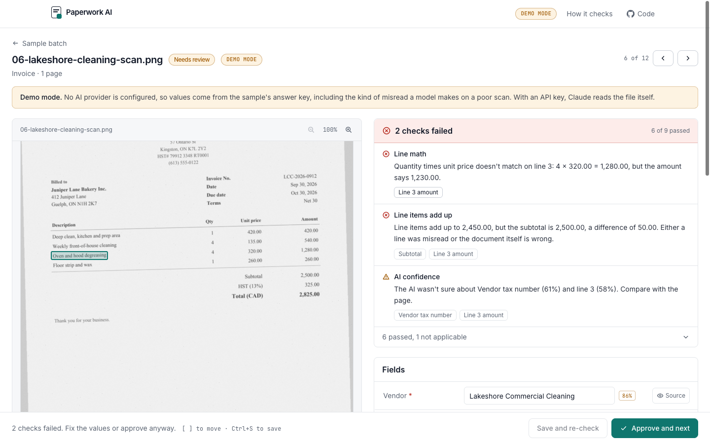
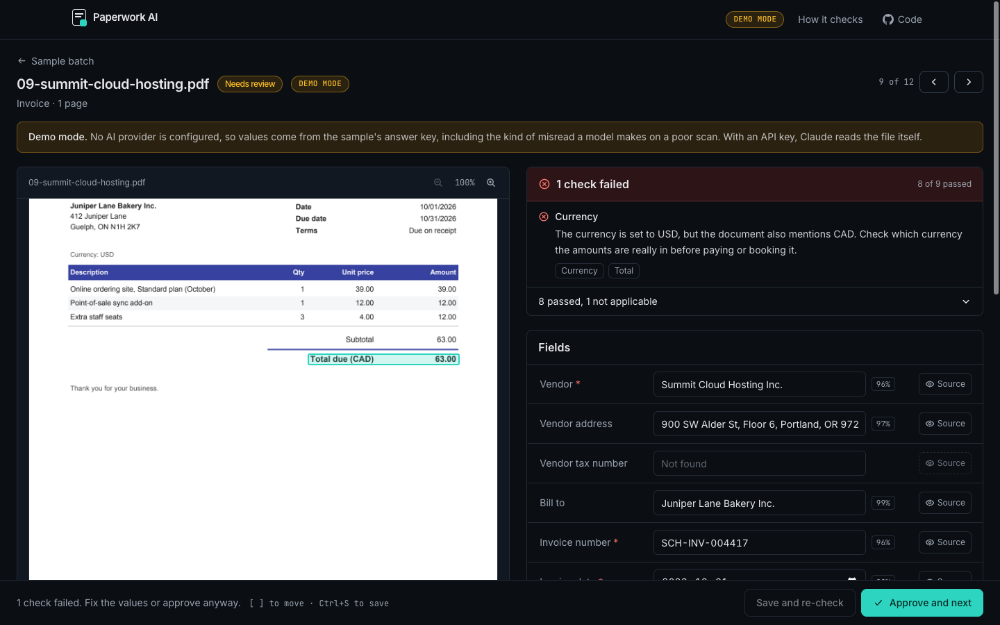
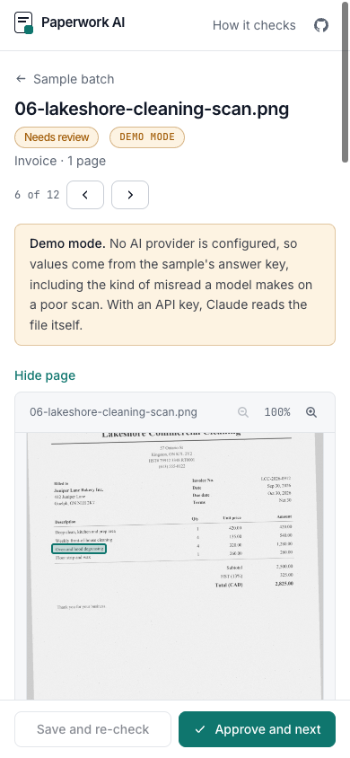
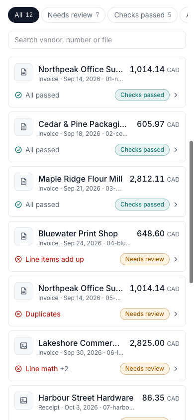
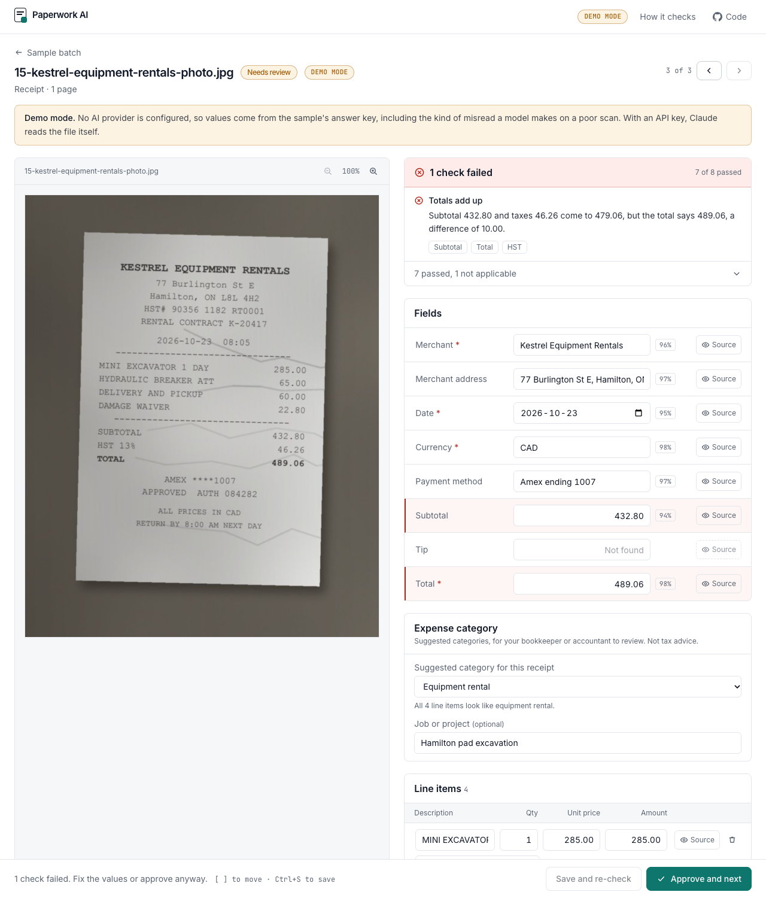
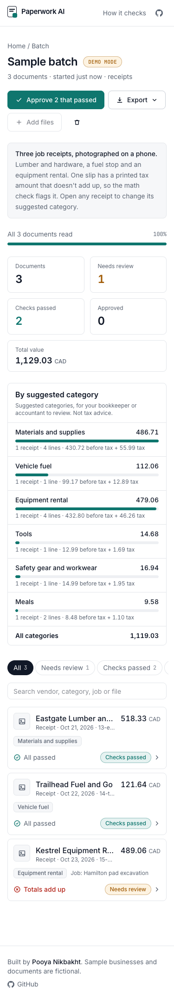
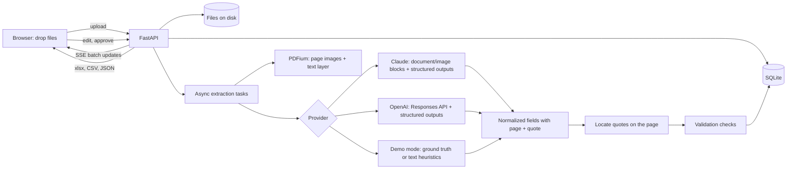

# Paperwork AI

**Stop typing invoices into spreadsheets.** Drop in a pile of supplier invoices, receipts and forms (PDFs, scans or phone photos) and get back clean, checked rows you can export to Excel, CSV, Google Sheets or JSON.

It's built for small businesses, bookkeepers and office managers who spend hours a week on data entry. The AI does the reading. What makes it safe to use is the layer on top: every value shows exactly where on the page it came from, and every document goes through the checks a careful bookkeeper would do by hand before anyone approves it.

A portfolio project by Pooya Nikbakht, a senior full-stack engineer. FastAPI and Next.js, with Claude or OpenAI behind one interface and a demo mode that needs no API keys. Every business and document in the samples is fictional.



| Batch overview | Dark mode, PDF with a highlighted source |
|---|---|
|  |  |

| Phone: review | Phone: batch |
|---|---|
|  |  |

### Receipts mode, for trades and small contractors

Switch the home screen from **Invoices** to **Receipts** and snap phone photos of crumpled job receipts: hardware store, fuel, equipment rental. Each receipt is read, checked with the same math checks, and given a **suggested expense category** with a short reason, for a bookkeeper or accountant to review. This is a suggestion only: the app never calls anything a tax write-off and gives no tax advice.

| Desktop: category and job tag per receipt | Phone: batch with category summary |
|---|---|
|  |  |

- **Categories:** Materials and supplies, Vehicle fuel, Equipment rental, Tools, Safety gear and workwear, Meals, Office and admin, Other. Each line and the receipt as a whole get one, with a reason such as `The description mentions "excavator".` Change any of them from a dropdown, and add an optional **job or project** tag per receipt.
- **Same checks, same review screen.** A slip whose printed HST doesn't add up to the total is held for review with the plain-language message.
- **Export** adds a category column (CSV and Excel), a job column, and a **By category** sheet in the workbook (also a CSV of totals by category). Tax is shared across a receipt's lines by amount, so each category total includes its part.
- **Built for a phone:** a Take a photo button opens the camera, and the batch shows cards with category chips instead of a table.
- **Three sample receipts** (`make sample`): a lumber yard, a fuel stop and an equipment rental, drawn with Pillow and photographed-looking (tilt, shadow, creases). The rental slip prints its HST 10.00 short on purpose. Open `/?mode=receipts` to land on the Receipts tab.
- **How the AI does it:** the receipt schema asks Claude (structured outputs, validated with pydantic) for a category from a closed list per line plus one for the receipt. An answer that isn't on the list is replaced by a small rule-based categorizer (`backend/app/categories.py`), which is also what demo mode uses.

## What it does

1. **Drop the pile.** Drag in up to 50 files at once. Pick auto-detect, invoices, receipts, or define your own fields (name, type, a hint for the AI) for forms.
2. **Watch it read.** Each document moves through *queued*, *reading*, then *needs review* or *checks passed*, live over server-sent events.
3. **Review side by side.** The page is on the left; the fields, line items and taxes are on the right. Each value has a confidence score and a **Source** button that highlights the exact text on the page.
4. **Fix and approve.** Edit anything; saving re-runs every check. Approve everything that passed in one click. Approving a document with a failed check asks you to confirm.
5. **Export.** Excel workbook (documents, line items, taxes and checks as sheets), CSV per document or per line, a Google Sheets-ready CSV, or full JSON.

Invoices capture vendor, tax number, bill-to, number, dates, currency, line items (quantity, unit price, amount), subtotal, each tax line (GST, HST, PST, QST and others) and total. Receipts capture merchant, date, items, taxes, tip, total and payment method.

## How the checks build trust

Models misread blurry scans, and suppliers make mistakes too. So no value is trusted just because the AI produced it.

| Check | What it catches | Example message |
|---|---|---|
| Line items add up | Line amounts don't sum to the subtotal | "Line items add up to 524.00, but the subtotal is 564.00, a difference of 40.00." |
| Totals add up | Subtotal plus taxes (and tip) isn't the total | "Subtotal 225.00 and taxes 29.25 come to 254.25, but the total says 264.25." |
| Line math | Quantity × unit price doesn't match a line | "Line 3: 4 × 320.00 = 1,280.00, but the amount says 1,230.00." |
| Tax rates | GST/HST/PST/QST that doesn't match Canadian rates | "HST is 13% in Ontario and 15% in the Atlantic provinces; this says 12%." |
| Dates | Dates that don't parse, are out of order or years away | "The due date is before the invoice date." |
| Currency | Unknown codes, or a document that mentions two currencies | "The currency is set to USD, but the document also mentions CAD." |
| Duplicates | Same vendor and invoice number as an earlier document | "Invoice NP-24817 from Northpeak already appears earlier in this batch." |
| Sources found | A quoted source that isn't actually on the page | "Couldn't find the quoted text for Total on the page." |
| AI confidence | Values the model itself was unsure about | "The AI wasn't sure about Payment method (64%)." |

Every check returns pass, warn, fail or skip, a plain sentence, and the fields involved, so the review screen can jump straight to them. The model is told to report what the page says and never to fix numbers, so a supplier's arithmetic error surfaces instead of being quietly corrected.

For PDFs with a text layer, each quote is searched for on the page (with PDFium) to draw the highlight. If it isn't there, that's a warning in itself: the cheapest guard against an invented value.

### Evals

Every sample document has ground-truth JSON, and the eval harness scores a provider against it:

```text
$ make eval                     # or: cd backend && uv run python -m app.evals --provider=mock

Document                                 Type      Fields   Lines  Checks failed              Result
--------------------------------------------------------------------------------------------------------
01-northpeak-office-supply.pdf           invoice    11/11   20/20  -                          ok
04-bluewater-print-shop.pdf              invoice    11/11   16/16  line_items_sum             caught
05-northpeak-office-supply-resent.pdf    invoice    11/11   20/20  duplicate                  caught
06-lakeshore-cleaning-scan.png           invoice    10/11   15/16  line_math, line_items_sum  misread, flagged
09-summit-cloud-hosting.pdf              invoice    11/11   12/12  currency                   caught
11-riverbend-courier.pdf                 invoice    11/11   12/12  totals                     caught
...
Summary
  Field accuracy              124/125 (99.2%)
  Line item accuracy          275/276 (99.6%)
  Document problems caught    4/4 (100.0%)
  Extraction mistakes caught  1/1 (100.0%)
  False alarms (clean docs)   0/7 (0.0%)
  Classification accuracy     12/12 (100.0%)
```

Those numbers are **demo mode**, which replays the ground truth plus a deliberate misread on the noisy scan, so they show the harness and the checks working, not model quality. Run `make eval PROVIDER=anthropic` (or `openai`) with a key to score a real model on the same documents. The two numbers that matter for a client are *extraction mistakes caught* (when the AI gets a number wrong, does a check flag it?) and *false alarms* (are clean documents left alone?).

## Sample documents

`make sample` regenerates twelve documents for "Juniper Lane Bakery", a fictional bakery in Guelph, Ontario, with fpdf2, Pillow and PDFium:

- Clean invoices with Ontario HST, British Columbia GST + PST, and Quebec GST + QST (with a written-out date)
- A two-page, 28-line ingredients invoice
- A scanned-looking invoice: grey paper, 1.4° tilt, noise and blur
- A phone photo of a till receipt on a counter, tilted, with uneven light
- A grocery e-receipt where only two items carry HST
- Planted problems: line items that don't add up, a total that's 10.00 too high, the same invoice sent twice, and a USD invoice whose total line says CAD
- A filled-in catering order form, read with custom fields

Receipts mode has its own three samples (`backend/sample/receipts.py`, listed in `receipts_manifest.json` so the 12-document batch and the eval are unchanged): `13-eastgate-lumber-hardware-photo.jpg`, `14-trailhead-fuel-and-go-photo.jpg` and `15-kestrel-equipment-rentals-photo.jpg`. All businesses are fictional.

Generation is deterministic (fixed dates, seeded noise), so the files and their SHA-256 hashes are stable. Ground truth is recorded while each document is drawn, so values and quotes can't drift from the page.

## Architecture



- **backend/** FastAPI on Python 3.12 (uv). `app/pipeline.py` runs extraction in asyncio tasks with a concurrency limit; `app/providers/` holds the adapters behind one `Extractor` interface; `app/validation.py` is the checks, each a small pure function; `app/exports.py` writes the files; `app/evals.py` is the harness.
- **frontend/** Next.js 16, TypeScript, Tailwind. Pages render in the browser and talk to the API directly. Deploys to Cloudflare Workers with OpenNext.

### AI providers

- **Claude** (default when `ANTHROPIC_API_KEY` is set) uses the official `anthropic` SDK. PDFs go in as `document` blocks and photos as `image` blocks; the answer comes back through structured outputs (`messages.parse` with a pydantic model generated from the field spec). Effort is set through `output_config.effort`. There's no temperature, thinking config, forced tool choice or prefill. The server-side refusal fallback is on for Opus models; Haiku has none, so it isn't sent. Citations can't be combined with structured outputs, so each field asks for its own verbatim quote and page instead.
- **OpenAI** uses the official `openai` SDK's Responses API with `input_file`/`input_image` and `responses.parse`. The model comes from `OPENAI_MODEL`, with no default.
- **Demo mode** needs no keys. Sample documents are matched by hash and replayed from ground truth, with the imperfections listed in `sample/demo_quirks.json`; other PDFs get regex heuristics over the text layer at low confidence. The UI labels it everywhere.

Provider failures (rate limits, outages, bad keys) fall back to demo mode for that document with a visible note; refusals don't, and the document is marked failed with the reason.

## Key decisions and trade-offs

- **Checks over confidence scores.** Model-reported confidence is shown, but the trust comes from arithmetic and source matching, which don't depend on the model grading itself.
- **Quotes, not coordinates.** Models are poor at bounding boxes, so they quote text and the app finds it on the page. Scans and photos have no text layer, so there the quote is shown for comparison by eye (demo mode supplies the generator's boxes).
- **One call per document.** The whole file goes to the model at once, which keeps line items in context across pages. Very long documents would need page batching.
- **SQLite and local disk.** Simple and fine for a demo that deletes everything hourly. It's the first thing to change for production.
- **Duplicates across batches** only count against approved documents, and never involve sample batches, which everyone re-runs. In the public demo they're off, so one visitor's invoices can't be probed from another session.

### What I'd do next in production

- Postgres and object storage (S3 or GCS), with per-organization accounts.
- Push approved documents straight into QuickBooks or Xero, and receive invoices by email forwarding.
- Vendor memory: learn each supplier's layout and usual tax setup, and flag changes (a new bank account on an invoice is a classic fraud signal).
- Page-level OCR for scans so their highlights can be verified too, and a human-labelled eval set from real (consented) documents.

## Run it locally

Requirements: [uv](https://docs.astral.sh/uv/) and Node 22 (`frontend/.nvmrc`).

```bash
make install    # uv sync + npm ci
make dev        # API on http://localhost:8040, app on http://localhost:3040
```

Open http://localhost:3040 and choose **Try 12 sample documents**, or switch to **Receipts** and choose **Try 3 sample receipts**. With no keys, everything runs in demo mode.

| Command | What it does |
|---|---|
| `make dev` | Backend (with reload) and frontend together |
| `make test` | Backend tests (pytest): checks, schemas, categories, exports, endpoints in demo mode, both adapters against mocked SDK transports |
| `make lint` | ruff, ESLint and TypeScript |
| `make sample` | Regenerate the sample documents and ground truth |
| `make eval` | Score a provider against the ground truth (`PROVIDER=mock\|anthropic\|openai`) |
| `make check` | Lint, test, eval and a production build |

### Environment variables

Backend (`backend/.env`, see `backend/.env.example`):

| Variable | Default | Purpose |
|---|---|---|
| `LLM_PROVIDER` | (auto) | `anthropic`, `openai` or `mock`. Empty picks by available key, else demo mode |
| `ANTHROPIC_API_KEY` | | Enables Claude |
| `ANTHROPIC_MODEL` | `claude-opus-5-5` | The public demo uses `claude-haiku-5-5` |
| `ANTHROPIC_EFFORT` | `medium` | `low` to `max` |
| `OPENAI_API_KEY` / `OPENAI_MODEL` | | Enables OpenAI; the model is required |
| `CORS_ORIGINS` | `http://localhost:3040` | Frontend origins, comma separated |
| `DATA_DIR` | `backend/data` | SQLite database and uploaded files |
| `PUBLIC_DEMO` | `false` | Applies the public limits below |
| `TRUST_PROXY_HEADERS` | `false` | Use `X-Forwarded-For` for per-IP limits behind a trusted proxy |
| `MAX_UPLOAD_MB`, `MAX_PAGES`, `MAX_FILES_PER_BATCH` | 20, 30, 50 | Upload limits |
| `LIVE_DOCS_PER_IP_PER_HOUR`, `LIVE_DOCS_PER_DAY` | 0 (off) | Caps on paid extractions; over the cap, documents use demo mode |
| `BATCHES_PER_IP_PER_HOUR` | 0 (off) | Rate limit on new batches |
| `DATA_TTL_SECONDS` | 0 (keep) | Delete batches and files older than this |
| `SAMPLE_PROVIDER` | `active` | `mock` runs the sample batch in demo mode even with a key |

`PUBLIC_DEMO=true` sets: 10 MB and 10 pages per file, 15 files per batch, 20 live documents per IP per hour and 200 per day, 20 batches per IP per hour, deletion after one hour, samples in demo mode, and no cross-batch duplicate matching. Anything set explicitly still wins.

Frontend (`frontend/.env.local`, see `frontend/.env.example`):

| Variable | Default | Purpose |
|---|---|---|
| `NEXT_PUBLIC_API_URL` | `http://localhost:8040` | The backend, inlined at build time |

## Deploy

Nothing here deploys automatically.

**API on Google Cloud Run** (scales to zero, starts in seconds):

```bash
cd backend
gcloud run deploy paperwork-api --source . --region northamerica-northeast2 \
  --allow-unauthenticated --max-instances 1 \
  --set-env-vars PUBLIC_DEMO=true,TRUST_PROXY_HEADERS=true,ANTHROPIC_MODEL=claude-haiku-5-5,CORS_ORIGINS=https://paperwork.example.workers.dev \
  --set-secrets ANTHROPIC_API_KEY=anthropic-key:latest
```

The image stores data under `/tmp`, which is fine for a demo that deletes everything within the hour. `--max-instances 1` keeps the SQLite file and the in-memory rate limits in one place.

**Frontend on Cloudflare Workers** (OpenNext):

```bash
cd frontend
NEXT_PUBLIC_API_URL=https://paperwork-api-xxxx.run.app npm run deploy
```

Set the same URL in `wrangler.jsonc` and replace the placeholder links in `src/config/site.ts`.

**Privacy for the public demo.** The upload panel reads "Demo only. Don't upload sensitive documents. Files are deleted within an hour." Live extraction uses a provider that doesn't train on API inputs.
